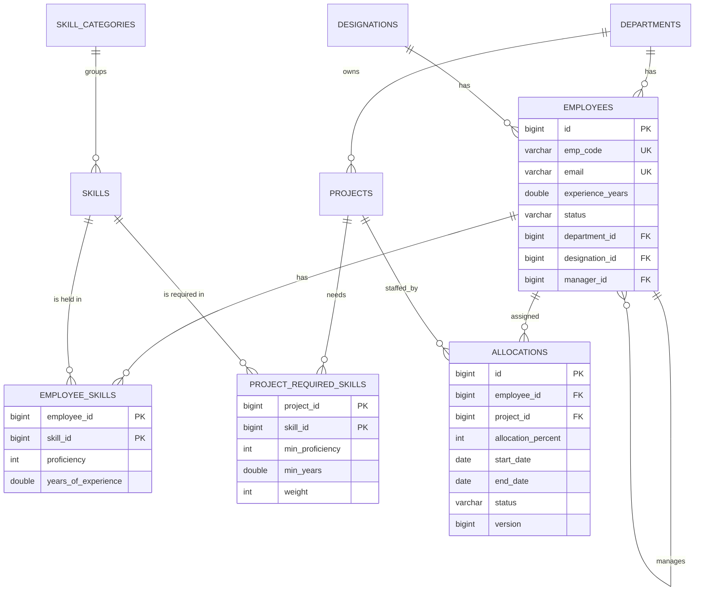
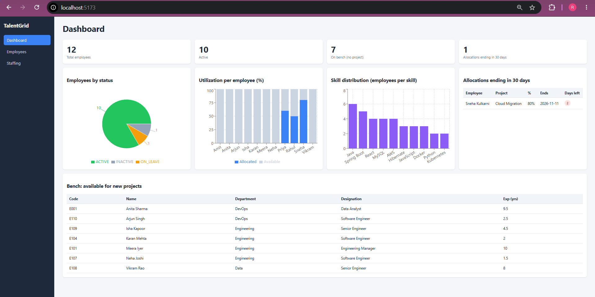
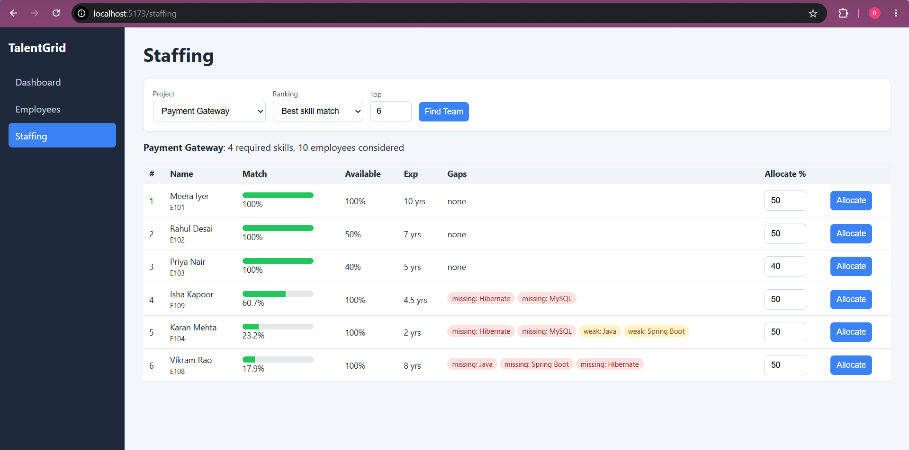
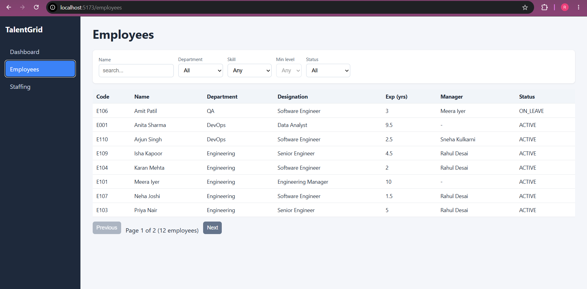
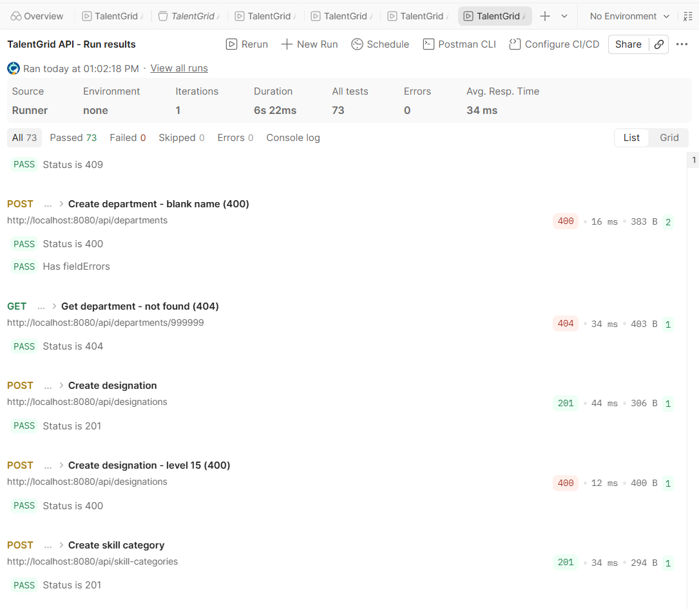

# TalentGrid: Employee Skill Matrix & Project Staffing Platform

A full-stack staffing platform that recommends the **best-fit employees for a project** using a weighted skill-matching engine, while preventing anyone from being allocated more than 100% of their time.

**Tech stack:** Java 17, Spring Boot, Hibernate/JPA (HQL and Criteria API), MySQL, React (Vite), REST API, Postman

---

## The problem it solves

| Without TalentGrid | With TalentGrid |
|---|---|
| Staffing decided by memory or guesswork | Data-based ranking with a match score |
| Employees accidentally overbooked | 100% allocation rule enforced by the backend |
| Skill gaps are hidden | Missing and weak skills shown for every candidate |
| No view of idle employees | Bench list, utilization and expiring-allocation reports |

## How it works

1. Store employees with skills (proficiency 1 to 5) and years of experience.
2. Define projects and the skills they need, each with a minimum level, minimum years and an importance weight.
3. Click **Find Team**: the engine scores every employee against the project and ranks them.
4. Allocate people to the project. The system blocks any allocation that would push someone over 100%.

**Score for each required skill:** `weight x min(level / minLevel, 1) x min(years / minYears, 1)`
**Match %** = total score divided by the sum of weights, times 100. A missing skill scores 0.

---

## Features

- Full CRUD for departments, designations, skill categories, skills, employees, projects and allocations
- **Matching engine** with three interchangeable ranking strategies: best skill match, most experienced, most available
- **Parallel scoring** with `CompletableFuture`
- **Dynamic employee search** (Criteria API): filter by name, department, status, minimum experience, skill and minimum skill level
- **Analytics** (HQL): bench list, utilization per employee, skill distribution, allocations ending soon
- **Over-allocation prevention** (100% rule) and **optimistic locking** (`@Version`) for safe concurrent edits
- Soft delete for employees and allocations (history is kept)
- Daily scheduled alert for allocations ending within 7 days
- Global exception handling with consistent error JSON (400, 404 and 409)
- React UI: Dashboard with charts, Employees with filters and paging, Staffing with "Find Team"

---

## Architecture

```
React (Vite)  --->  Controller  --->  Service  --->  Repository  --->  MySQL
  Axios            REST + DTOs      business rules     Spring Data JPA
                   validation       transactions       HQL, Criteria API
```

```
src/main/java/com/talentgrid
  controller   REST endpoints
  service      business logic and transactions
  repository   Spring Data JPA, HQL queries, Criteria API search
  entity       JPA entities and enums
  dto          request/response records
  matching     scoring logic (pure, thread-safe)
  strategy     ranking strategies (Strategy pattern)
  scheduler    scheduled allocation alerts
  exception    custom exceptions and global handler
  config       CORS, scheduling, demo data seeder
talentgrid-ui  React frontend
postman        Postman collection
```

---

## Database design (normalized to 3NF)



**Design decisions**

- **Many-to-many with extra data** (employee-skill, project-required-skill) is modeled as its own entity with a composite key (`@EmbeddedId` and `@MapsId`), not a plain `@ManyToMany`.
- **Allocations** have their own surrogate id because the same employee can be allocated to the same project more than once over time.
- **Lookup tables** for departments, designations and skill categories keep the schema in 3NF (no repeated names).
- **Self-reference:** an employee's manager is another row in `employees`.

---

## Technical highlights

- **Strategy pattern:** Spring injects every `MatchingStrategy` bean into a list, so a new ranking rule is one new class and nothing else changes.
- **Parallel scoring without lazy-loading problems:** data is loaded in three queries and copied into plain records before worker threads score it. Threads never touch Hibernate entities.
- **Optimistic locking:** `@Version` on allocations. A stale update returns 409 instead of silently overwriting.
- **N+1 avoided:** `@EntityGraph` and `JOIN FETCH` on list queries, with `spring.jpa.open-in-view=false`.
- **Criteria API dynamic search:** predicates are added only for filters that were provided, with a separate count query for paging.
- **HQL:** `GROUP BY`, `SUM`, `AVG`, `NOT EXISTS` and `SELECT new` DTO projections.

---

## REST API (50 endpoints)

| Resource | Endpoints |
|---|---|
| Departments | `POST GET GET/{id} PUT/{id} DELETE/{id}` on `/api/departments` |
| Designations | same, on `/api/designations` |
| Skill categories | same, on `/api/skill-categories` |
| Skills | same, on `/api/skills` (optional `?categoryId=`) |
| Employees | same, on `/api/employees` (paged: `?page=&size=&sort=`; DELETE is a soft delete) |
| Employee search | `GET /api/employees/search?departmentId=&skillId=&minProficiency=&status=&name=&minExperience=` |
| Employee skills | `POST GET /api/employees/{id}/skills`, `PUT DELETE /api/employees/{id}/skills/{skillId}` |
| Projects | `POST GET GET/{id} PUT/{id} DELETE/{id}` on `/api/projects` |
| Required skills | `POST GET /api/projects/{id}/required-skills`, `PUT DELETE .../{skillId}` |
| **Recommendations** | `GET /api/projects/{id}/recommendations?top=5&strategy=WEIGHTED` (also `EXPERIENCE_FIRST`, `AVAILABILITY_FIRST`) |
| Allocations | `POST GET GET/{id} PUT/{id}` on `/api/allocations` (`?employeeId=` or `?projectId=`); `DELETE` releases (status CANCELLED) |
| Analytics | `GET /api/analytics/bench`, `/utilization`, `/skill-distribution`, `/summary`, `/expiring-allocations?days=30` |

**Status codes used:** 200, 201, 204, 400 (validation or business rule), 404 (not found), 409 (duplicate, record in use, over-allocation, stale version).

---

## Screenshots

> Add your screenshots to a `docs/` folder and update these paths.

| Dashboard | Staffing: Find Team |
|---|---|
|  |  |

| Employees | Postman Runner |
|---|---|
|  |  |

---

## Getting started

**Prerequisites:** JDK 17, Maven, MySQL 8, Node.js 18 or newer

### 1. Database

```sql
CREATE DATABASE talentgrid CHARACTER SET utf8mb4;
```

### 2. Backend

Open `src/main/resources/application.properties` and set your MySQL password:

```properties
spring.datasource.username=root
spring.datasource.password=YOUR_PASSWORD
```

Run it (`mvn spring-boot:run`, or run `TalentgridApplication` from your IDE). Tables are created automatically, and demo data (10 employees, 10 skills, 3 projects and allocations) is loaded on first start. Set `app.seed.enabled=false` to turn that off.

The API runs at `http://localhost:8080`.

### 3. Frontend

```
cd talentgrid-ui
npm install
npm run dev
```

Open `http://localhost:5173`. (The backend allows CORS from this port.)

---

## Testing

**Unit tests:** JUnit 5 tests for the scoring logic and ranking strategies (no database needed):

```
mvn test -Dtest=ScoreCalculatorTest
```

**API tests (Postman):** import `postman/TalentGrid.postman_collection.json`, start the backend, and run the collection with the Collection Runner. It contains 52 requests and 73 test assertions covering the full flow: create data, match, allocate, over-allocate (409), stale update (409), soft delete and analytics. Each run creates its own unique data, so it can be repeated.

---

## Possible improvements

- JWT authentication with admin and manager roles
- Skills and Projects management pages in the UI
- `ContractEmployee` subtype using JPA inheritance
- Email or Slack notifications for expiring allocations
- Docker Compose for one-command startup
